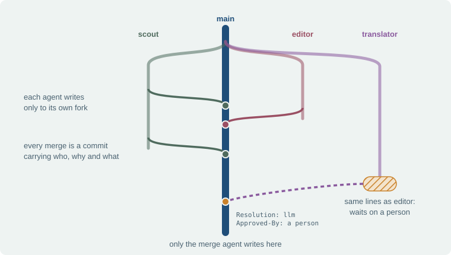
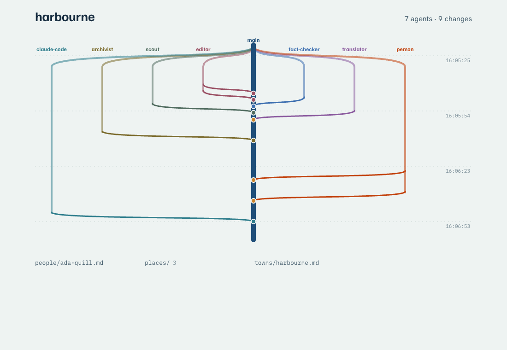

# braid

Shared memory for many AI agents, on [Cloudflare Artifacts](https://developers.cloudflare.com/artifacts/).

Every agent writes to its own fork. A merge agent folds those forks into `main`, record by record. Only a real conflict waits for a person, who settles it from a phone. Every record keeps its history, and undo is one tap that can itself be undone. A braided river splits into channels and rejoins: that is what forks and merges do.

## Why

When many agents write one shared folder, two writers on one file means one of them loses. Locks make agents wait on each other; last-write-wins loses work quietly. Git solved this for people, but a git host built for people gives an agent too much (any write token can push `main`) and too little (no merge you can call from code).

Artifacts gives you git repos you can create, fork and push from a Cloudflare Worker, and nothing else: no merge, no branch protection, no pull requests. braid is the missing middle: its core is about 2,000 lines of TypeScript.

## How it works



```
 agent ──envelope──▶ Lane (one per agent) ──git push──▶ fork  <repo>--<agent>
                                                          │
                                       MergeAgent (one per repo) folds each lane commit
                                                          ▼
                                     main  ◀── two-parent merge commit with trailers
                                       │
                        conflict? ──▶ approval ──▶ a person: Approve / Keep main / Take theirs / Edit
```

**One contract.** Every write is an envelope naming exactly what it changed and what it started from:

```ts
type Envelope = {
  agent: string
  changes: { path: string; base: string | null; content: string | null }[] // base: the blob read; null content deletes
  reason: string
  source?: string
}
```

One envelope becomes one commit on the agent's fork, with trailers (`Agent:`, `Source:`, one `Record-Path: <path> <base>` per change). Only the merge agent writes `main`; its merge commit copies those trailers and adds `Lane-Commit:`, `Resolution: clean | field | llm | human` and, when a person decided, `Approved-By:`. An undo adds `Reverts:`.

**Merging is per record**, from three texts: the blob the writer edited from, main's version now, and the writer's version.

| Case | Result |
|---|---|
| Different files | clean |
| Same file, different frontmatter keys | clean (field merge) |
| `last_edited_*` on both sides | follow the later edit, as a group |
| Same file, different `##` sections | clean |
| Same section, lines merge cleanly (diff3) | clean |
| Same section, overlapping lines | a model proposes a merge; a person approves, edits or picks a side |
| Edit against delete | a person decides |

**Why a fork per agent:** Artifacts tokens are scoped to a repo, and there is no branch protection, so a branch per agent would let any agent push `main`. A fork per agent means an agent's token reaches only its own lane.

**Undo is a write.** It asks for the record as it was before a commit, editing *from* what that commit produced. So an undo never clobbers a later edit: if the lines overlap, it becomes an approval. An undo of an undo restores.

**Agents that only know git work too.** A plain `git push` to a fork, with no envelope, is merged as that lane's agent; the diff is the envelope.

## Measured on Artifacts (open beta, October 2026)

- The server refuses a stale ref update ("stale ref"): ten rounds of truly concurrent pushes from one base, one winner each time. braid needs no lock of its own.
- Eight lanes merging into one `main` at once: all land, in about 8 s.
- `fork()` about 4 s; a merge (two shallow fetches, a two-parent commit, a push) about 0.4 s from a Worker.
- Concurrent `fork()` of one repo fails, so lanes are forked one at a time.

## Run it

You need Node (tested on 26) and a Cloudflare account on the Workers Paid plan with [Artifacts](https://developers.cloudflare.com/artifacts/get-started/) available (open beta). The Worker also binds Workers AI and two Durable Objects; deploying creates them.

**1. Make it yours.** In `wrangler.jsonc`, change `name` (the Worker), the Artifacts `namespace` (created the first time a repo is made in it) and `REPO` (the repo the viewer shows). Deploying with someone else's name would replace their Worker if you share an account.

**2. Install and deploy.** With an API token instead of `wrangler login`, give it Workers Scripts Edit, Artifacts Edit and Workers KV Storage Read, and set `CLOUDFLARE_API_TOKEN` and `CLOUDFLARE_ACCOUNT_ID`.

```sh
npm install                 # npm 11 may warn that postinstall scripts are not approved; the build does not need them
npx wrangler login          # skip with an API token
npm run deploy              # prints your URL: https://<name>.<your-subdomain>.workers.dev
```

**3. Set the two keys.** `SPIKE_KEY` runs the scenario; `ACT_KEY` lets whoever holds it approve and undo until Cloudflare Access is in front. Keep them in your shell (lost the shell? run these again; a new value replaces the old):

```sh
SPIKE_KEY=$(openssl rand -hex 24); printf %s "$SPIKE_KEY" | npx wrangler secret put SPIKE_KEY
ACT_KEY=$(openssl rand -hex 24);   printf %s "$ACT_KEY"   | npx wrangler secret put ACT_KEY
URL=https://<name>.<your-subdomain>.workers.dev    # the URL deploy printed
```

**4. Play the story** (five agents, one approval, an undo and its undo, a plain-git agent). Unattended, on a throwaway `scene-*` repo, the runner plays the person too. Open `$URL/?repo=scene-1` in a browser first to watch it fill; the command waits about two minutes, then prints one JSON object. Success is `"pass": true` with every entry in `checks` true.

```sh
curl -X POST -H "Authorization: Bearer $SPIKE_KEY" "$URL/spike/scenario?repo=scene-1"
```

To play the person yourself, run it on `REPO` in interactive mode. It deletes and rebuilds that repo, so it asks you to name it twice:

```sh
curl -X POST -H "Authorization: Bearer $SPIKE_KEY" "$URL/spike/scenario?repo=harbourne&rebuild=harbourne&mode=interactive"
```



While it runs, open `$URL/` and approve, undo and undo the undo when it waits on you. To act from a phone, open `$URL/#key=<ACT_KEY>` once on that phone.

**Clean up.** Each run leaves its repo plus one fork per agent (eight in all). With `NS` your namespace and `R` the repo:

```sh
for r in "$R" "$R"--{scout,fact-checker,editor,translator,archivist,person,claude-code}; do
  npx wrangler artifacts repos delete "$r" --namespace "$NS" --force
done
npx wrangler delete <name>      # without KV read on the token, this deletes and then prints an auth error and your account list
```

`npm test` runs the merge table and the merge path against real git repos on a local `git http-backend`, no mocks.

## Layout

| Path | What |
|---|---|
| `src/contract.ts` | The envelope, trailers, strict parsing |
| `src/merge.ts` | The merge table (pure) |
| `src/merge-lane.ts` | Folding lane commits into `main` |
| `src/git/` | A bare in-memory git store on isomorphic-git |
| `src/do/lane.ts`, `src/do/merge-agent.ts` | The two Durable Objects |
| `src/primitives.ts` | `history` and `revert` |
| `src/api.ts`, `viewer/` | The viewer and its API |
| `docs/design.md` | The build spec |

## Not here

Pull requests, issues, CI, multi-tenant hosting, binary files. Scale beyond what is measured above is not claimed.

MIT licensed.
